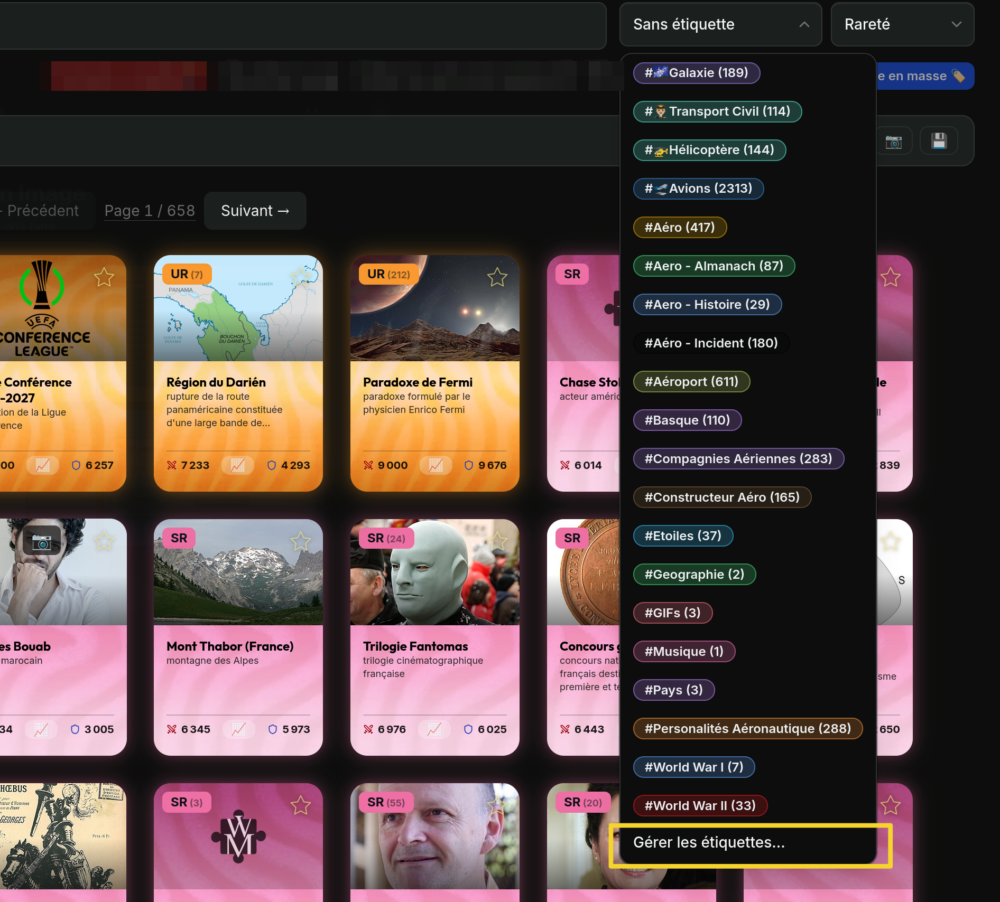
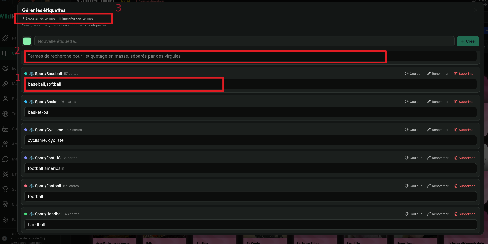
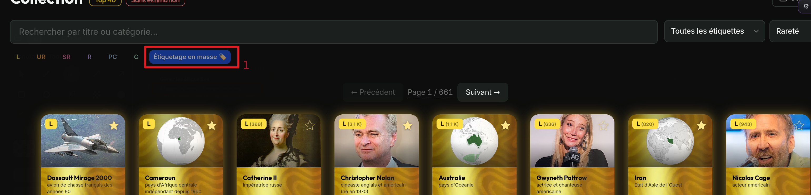
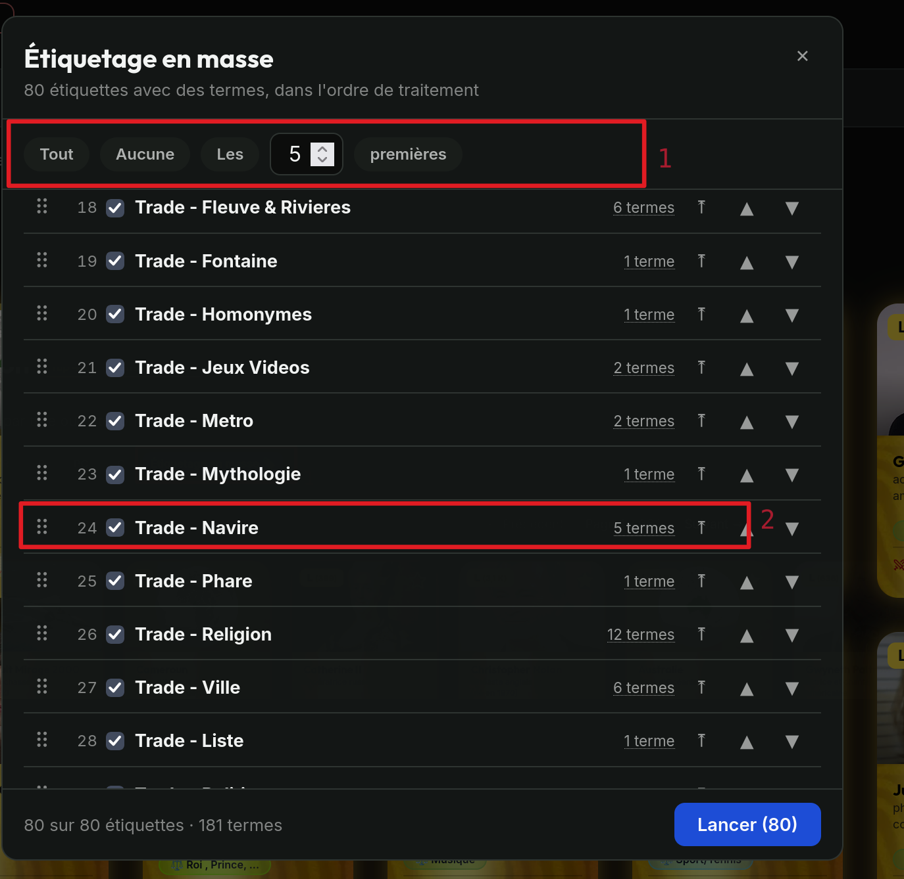
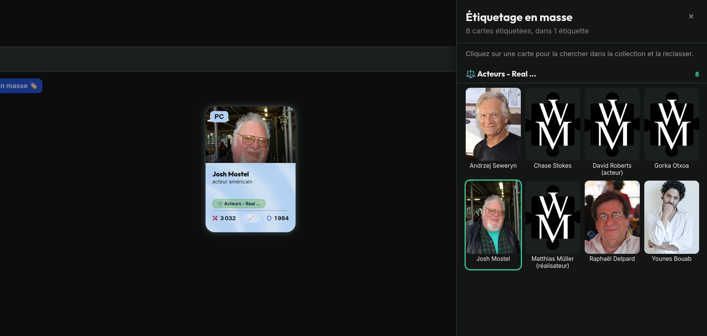

# Tutoriel : l'étiquetage en masse

L'étiquetage en masse range votre collection à votre place. Vous indiquez, pour chaque étiquette, quelques **termes de recherche** (« louvre, versailles, panthéon » pour l'étiquette *Monument*, par exemple). Le script les cherche un par un dans votre collection et applique l'étiquette à toutes les cartes trouvées qui n'en ont pas encore.

Cette fonction existe dans Wiki-MasterBetter (script complet) comme dans la [version allégée](../README.md#version-allégée). Elle se trouve sur la page **Collection** (`/collection`).

> Les captures d'écran de ce tutoriel ont été prises sur une page de démonstration qui reprend la structure de la page Collection, avec des cartes fictives. Les fenêtres du script (les champs de termes, la fenêtre de sélection, le récapitulatif) sont, elles, celles du vrai script. Les couleurs et la mise en page du site peuvent différer légèrement chez vous.

Il suffit de quatre étapes : définir les termes, ouvrir la sélection, laisser tourner, relire le récapitulatif.

---

## 1. Ouvrir « Gérer les étiquettes »

Sur la page Collection, ouvrez la liste **« Toutes les étiquettes »** (1), puis choisissez **« Gérer les étiquettes… »** tout en bas (2).



Vos étiquettes doivent déjà exister : créez-les ici si besoin, comme d'habitude. La fenêtre est plus large qu'avant (jusqu'à 90 % de l'écran) pour que les noms longs restent lisibles.

## 2. Écrire les termes de recherche de chaque étiquette

Sous le nom de chaque étiquette, le script ajoute un **champ de termes** (1). Tapez-y les mots à chercher, **séparés par des virgules** :

```
louvre, versailles, panthéon
```

Une étiquette dont le champ est vide (2) est simplement ignorée par l'étiquetage en masse. Les termes sont enregistrés au fil de la frappe, dans votre navigateur : pas de bouton « Enregistrer ». Si vous renommez une étiquette, ses termes la suivent.



Quelques conseils pour bien choisir les termes :

- **La recherche du site couvre aussi les catégories**, pas seulement les titres. Un terme trop général (« france ») ramènera des cartes que vous ne voulez pas dans cette étiquette. Préférez des termes précis.
- Un terme court peut ramener bien plus de cartes qu'attendu. Testez-le d'abord à la main dans la barre de recherche de la collection : parmi les cartes que vous y voyez, le script étiquettera celles qui n'ont encore aucune étiquette.

### Sauvegarder ou transférer vos termes

Sous le titre de la fenêtre, deux liens (3) :

- **⬇ Exporter les termes** enregistre tous vos termes et l'ordre de traitement dans un fichier `wmb-etiquetage-en-masse.json` ;
- **⬆ Importer des termes** charge un tel fichier (par exemple sur un autre ordinateur, avec le même compte). Les termes des étiquettes présentes dans le fichier sont remplacés ; les autres étiquettes ne sont pas touchées.

Fermez ensuite la fenêtre (touche Échap ou clic à côté).

## 3. Lancer l'étiquetage en masse

À la fin de la barre de filtres de la collection, le script a ajouté le bouton **« Étiquetage en masse 🏷️ »** (1). Cliquez dessus.



Si aucune étiquette n'a de termes, le bouton vous le dit et vous renvoie à l'étape 2. Sinon, une fenêtre vous laisse choisir **quoi lancer et dans quel ordre** :



- **Les cases à cocher** : décochez une étiquette pour la sauter cette fois-ci (sa ligne s'estompe).
- **La barre du haut** (1) : « Tout » et « Aucune » cochent ou décochent tout ; « Les *N* premières » ne garde que les *N* premières étiquettes de la liste (ici, 3 sur 4, la dernière est décochée).
- **L'ordre des lignes** (2) : il compte ! Une carte qui correspond à plusieurs étiquettes reçoit **la première de la liste** (seules les cartes sans étiquette sont touchées, donc la première qui la trouve gagne). Mettez *Oiseau* avant *Espèce* si vous voulez qu'une espèce d'oiseau soit rangée avec les oiseaux. Pour déplacer une ligne : les boutons **⤒** (tout en haut), **▲** et **▼**, ou glisser-déposer par la poignée ⠿ à gauche. L'ordre est mémorisé pour la prochaine fois.
- **Le pied de fenêtre** (3) : il rappelle combien d'étiquettes et de termes vont tourner. **« Lancer (N) »** démarre l'opération. Échap ou ✕ annule sans rien faire.

### Pendant l'opération

Le bouton de la barre de filtres devient **« ⏹ Arrêter l'étiquetage »**. Le script fait seul ce que vous feriez à la main : il filtre sur « Sans étiquette », tape chaque terme dans la recherche, sélectionne toutes les cartes trouvées, appuie sur « Étiqueter » et choisit l'étiquette, jusqu'à ce qu'il n'y ait plus rien à étiqueter pour ce terme. Puis il passe au terme suivant, puis à l'étiquette suivante.

À savoir pendant ce temps :

- **Gardez l'onglet visible** et la fenêtre non réduite : les navigateurs ralentissent les onglets en arrière-plan, et l'opération s'en trouverait très ralentie. Ne touchez pas à la page (recherche, sélection, filtres) tant qu'elle tourne.
- **Rien ne peut être étiqueté deux fois** : seules les cartes **sans aucune étiquette** sont sélectionnées. Vos cartes déjà rangées ne bougent jamais.
- **Vous pouvez arrêter à tout moment** avec le même bouton. Les cartes déjà étiquetées le restent ; le filtre, la recherche et le mode sélection sont remis à zéro.
- Le site s'affiche parfois de travers : si une étape échoue, le script la retente une fois (il ferme la fenêtre ouverte, attend que la page se calme, puis recommence). S'il échoue de nouveau, il s'arrête et vous explique ce qu'il a trouvé à la place de ce qu'il attendait, avec la mention « après une nouvelle tentative ».
- Le déroulement est écrit dans la console du navigateur (F12, lignes qui commencent par `[WMB-MTG]`), utile si vous devez signaler un problème.

## 4. Relire le récapitulatif

Quand l'opération se termine (terminée, arrêtée ou en erreur), un panneau s'ouvre à droite : il liste, **étiquette par étiquette**, chaque carte qui vient d'être étiquetée, avec son portrait. Le titre de chaque étiquette (1) reste collé en haut pendant qu'on fait défiler ses cartes, avec leur nombre.



C'est le moment de vérifier que les termes n'ont pas ramené de cartes indésirables. Le panneau laisse la page utilisable : **cliquez sur une carte** (2) et son nom est tapé dans la recherche de la collection ; elle apparaît dans la grille, et vous pouvez l'ouvrir et lui donner une autre étiquette. Si l'opération s'est arrêtée sur une erreur, le message est affiché en haut du panneau. Seule la croix ✕ ferme le récapitulatif.

---

## En résumé

| Je veux… | Je fais… |
| --- | --- |
| Définir ce que cherche une étiquette | Collection → « Toutes les étiquettes » → « Gérer les étiquettes… » → champ sous l'étiquette, termes séparés par des virgules |
| Lancer | Bouton « Étiquetage en masse 🏷️ » → cocher/ordonner → « Lancer (N) » |
| Choisir qui gagne quand une carte correspond à deux étiquettes | Mettre l'étiquette prioritaire plus haut dans la liste |
| Arrêter en cours de route | Même bouton, devenu « ⏹ Arrêter l'étiquetage » |
| Corriger une carte mal rangée | Récapitulatif → clic sur la carte → la rouvrir et changer son étiquette |
| Reprendre mes réglages sur un autre ordinateur | « Gérer les étiquettes » → « ⬇ Exporter les termes » puis « ⬆ Importer des termes » |
